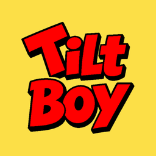
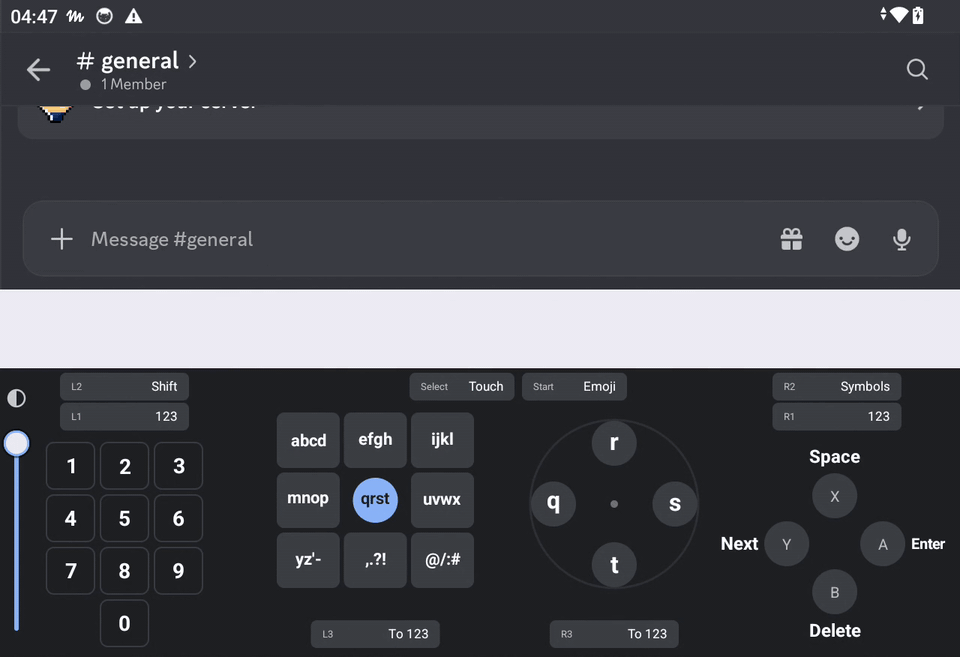

# TiltBoy Keyboard



Android の携帯ゲーム機で、スティックを使って文字を打つキーボードです。
左スティックでキーを選び、右スティックを倒して字を打ちます。
日本語（かな漢字変換つき）、英字、数字が打てます。

[English](README.md)



先に正直に書いておくと、スティックで打つのはタッチより遅いです。コントローラーから手を離したくないときのためのキーボードです。

## できること

- **1 文字 1 動作。** 左スティックでキーを選び（倒さなければ真ん中のキー）、右スティックを字の方向へ倒して戻すと入ります。カーソルをキーの上で動かす必要はありません。
- **どのモードも同じ打ち方。** かな・英字・数字で、キーの並び方、ボタン、画面の案内が共通です。
- **ゲームの邪魔をしない。** コントローラーを読むのは、キーボードが画面に出ている間だけです。ゲームやエミュレーターには、いつもどおりボタンが届きます。
- **インターネットの権限なし。** アプリが求める権限は振動だけです。音声入力は外してあります。
- **かな漢字変換。** 変換は、土台にしたオープンソースのキーボード [Sumire 日本語キーボード](https://github.com/KazumaProject/JapaneseKeyboard) のものです。

## 動作確認した機種

| 機種 | Android | |
|---|---|---|
| Anbernic RG477V | 14 | 確認済み |
| AYN Thor | 13 | 確認済み（上下どちらの画面でも） |

スティックが 2 本ある Android の携帯ゲーム機なら動くはずです。
スティックの動きがキーボードまで届かない機種では、自動で十字キー用の並びに切り替わります。
うまく動かないときは、TiltBoy の「試し打ち・コントローラーの確認」で症状を出し、ログを Issue に貼ってください。

Android 7.0 以降。

## 入れ方

1. [Releases](../../releases) から `tiltboy-*.apk` をダウンロードし、端末で開きます。提供元不明のアプリの許可を求められたら許可してください。
2. **TiltBoy** を開き、「はじめに」で次の 2 つを済ませます。
   - **ボタンの並び**: 自分の端末と同じ見た目の絵（X が上か、Y が上か）を選ぶ
   - **キーボードを使えるようにする**: TiltBoy をオンにして、TiltBoy に切り替える
3. 好きな入力欄をタップします。コントローラーがつながっていれば、すぐに案内が出ます。

新しい版は古い版の上からそのまま入り、設定も残ります。
[Obtainium](https://github.com/ImranR98/Obtainium) を使えば、このリポジトリの更新を自動で確認できます。

配布している APK の署名証明書（SHA-256）:
`5e7db81ac8a1e6b72deb222f9d8b46304d382ee909faab45314034a5a7d9b46c`

## 操作

画面の案内に、すべてのキーとボタンが出ます。覚える必要はありません。
以下は初期設定です。ボタンの役目は「細かい調整」で変えられます。

### かな

- 左スティック: ↖か ↑さ ↗た / ←な **真ん中（倒さない）あ** →は / ↙ま ↓ら ↘や・わ
- 右スティック: 五角形。真上が あ段 で、時計回りに い・う・え・お
- や・わ のキーだけ、右の輪が 6 つ: ↑や ↗ゆ ↘よ ↓わ ↙を ↖ん
- 押しながら打つ: L2 = 濁点、L1 = 半濁点、R1 = 小さい字
- R2 を押しながら左スティックを倒して戻す: ↖〜 ↑。 ↗… / ←ー →、 / ↙？ ↓・ ↘！
- 右スティックは、戻す前なら縁に沿って回して選び直せます

### ボタン

| ボタン | 役目 |
|---|---|
| A | 決定（何も打っていないときは改行・送信） |
| B | 1 文字消す（変換中は、変換をやめて 1 文字消す） |
| X | 空白 |
| Y | 変換・次の候補（英字では予測候補） |
| 十字キー | カーソル移動。変換中は ← → で候補、↑ ↓ で変換する範囲を長く・短く |
| L3 / R3（押し込み） | 前 / 次のモード（かな・英字・数字） |
| Select | 案内とタッチのキーボードの切り替え（長押しでキーボードを隠す） |
| Start | 絵文字の一覧 |

### 英字・数字

- 英字: `abcd` `efgh` `ijkl` / `mnop` `qrst` `uvwx` / `yz'-` `,.?!` `@/:#`。各キーの ← ↑ → ↓ が 1〜4 文字目
- 数字: `1234` `5678` `90.,` / `+-*/` `(=)%` `¥$€&` / `!?'"` `~@_#` `<:>;`
- 英字で L2 を押しながら = 大文字。L1 か R1 を押している間は数字の並び
- R2 を押しながら左スティック = キーにない記号

### そのほか

- 案内の左にある 1〜9・0 は、指で触っても入ります
- 案内のいちばん左のつまみを下げると、案内が透けて（20% まで）、後ろのアプリが読めます

## ビルド

JDK 21 と Android SDK（platform `android-37`、build-tools `37.0.0`、NDK `29.0.14206865`）が必要です。

```sh
./gradlew :pad_input:test                  # コントローラー部分のテスト（JVM だけで動く。速い）
./gradlew :app:assembleLiteFdroidRelease   # app/build/outputs/apk/liteFdroid/release/ にできる
```

`local.properties` に自分の鍵（`KEYSTORE_FILE`、`KEYSTORE_PASSWORD`、`KEY_ALIAS`、`KEY_PASSWORD`）を書かない限り、署名なしの APK になります。
違う鍵で署名した APK は、配布版の上からは入りません。

コードの場所:

- `pad_input/`: コントローラーの処理（スティックとボタンの状態から、何を打つかを決める）。Android に依存しない Kotlin と、そのテスト
- `app/src/main/java/com/kazumaproject/markdownhelperkeyboard/pad/`: Android 側。キーボードの中でコントローラーを読み、案内を描き、TiltBoy の設定画面を持つ。`TiltBoyPolicy` は TiltBoy で使わない Sumire の設定を固定する
- `app/src/liteFdroid/`: TiltBoy のアプリ名とアイコン（`liteFdroid` のビルドが TiltBoy）
- それ以外はすべて Sumire のもの

## クレジット

- **Sumire 日本語キーボード**（作者 Kazuma Naka さん、[KazumaProject/JapaneseKeyboard](https://github.com/KazumaProject/JapaneseKeyboard)、MIT）。TiltBoy は Sumire v1.7.139（コミット `16915fb`）から始めています。かな漢字変換、辞書、タッチのキーボード、絵文字の一覧は Sumire のものです。TiltBoy は非公式のフォークなので、TiltBoy の問題は Sumire ではなく、こちらに報告してください。Sumire 本来の README は [README.sumire.md](README.sumire.md) に残してあります。
- AI assisted（AI を使って作っています）
- 辞書などの第三者の素材: [THIRD-PARTY-NOTICES.md](THIRD-PARTY-NOTICES.md)、[docs/licenses/](docs/licenses/)、アプリの「このアプリについて」（バージョン・ライセンス）
- **関連研究。** いちばん近いのは、2 本のジョイスティックでフリック入力のように日本語を打つ研究 JoyFlick です。横山海青・高倉礼・志築文太郎・川口一画「フリック入力に基づく 2 本の押し込み機能付きジョイスティックを用いたテキスト入力手法」ヒューマンインタフェース学会論文誌 23(4), 2021。英語版は Yokoyama, Takakura, Shizuki, INTERACT 2021（[公開版](https://inria.hal.science/hal-04292388)）。JoyFlick は PC と Switch Pro コントローラーで動く試作で、かな漢字変換はありません。TiltBoy は、その論文の「人は左右のスティックをほぼ同時に離す」という結果を取り入れ、キーをはじき終わりではなく、はじき始めの時点で決めています。

## ライセンス

MIT（Sumire と同じ）。[LICENSE](LICENSE) を見てください。

TiltBoy は個人のプロジェクトで、任天堂、Anbernic、AYN、Sumire のプロジェクトとは関係ありません。
